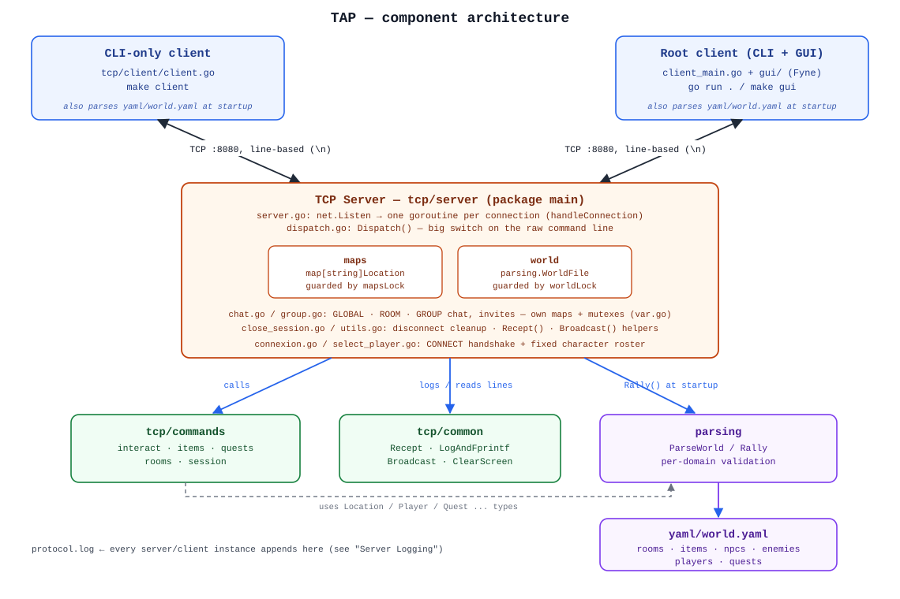
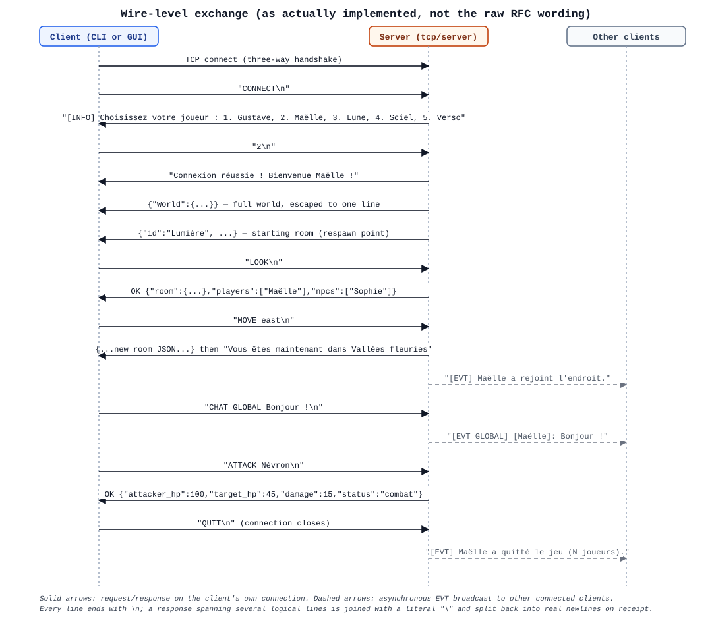
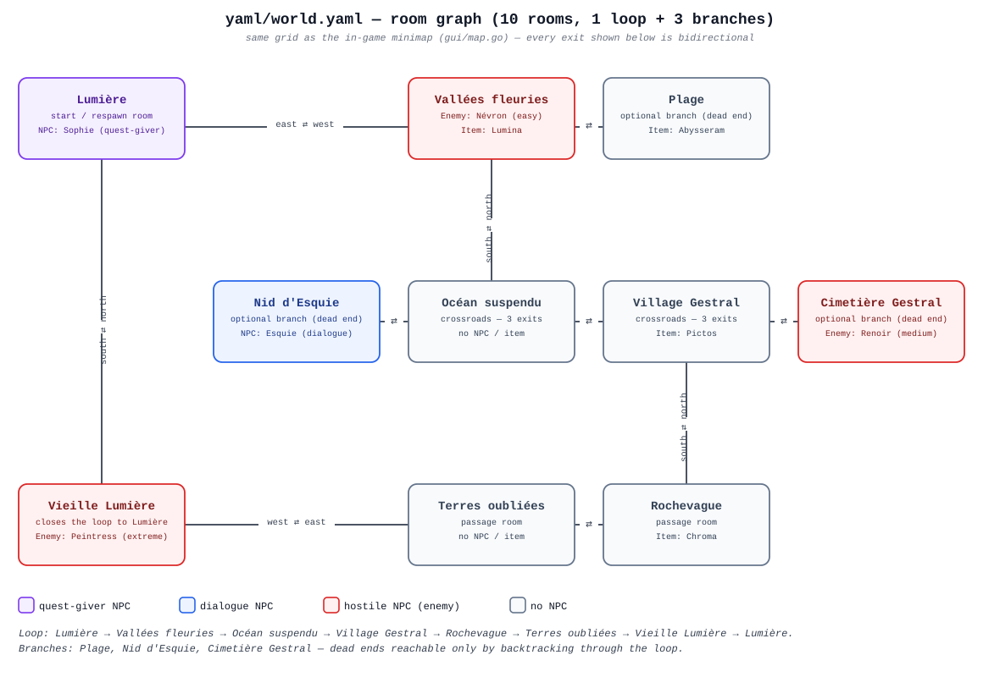

*This project has been created as part of the 42 curriculum by bbeaurai, fcaval, hguesne.*

# TAP — The Answer Protocol

## Description

TAP ("The Answer Protocol") is a shared-world, TCP-based multiplayer text adventure — a MUD — built for the 42 School group project of the same name. A single Go server hosts one persistent world (rooms, items, NPCs, enemies and quests, all loaded from `yaml/world.yaml`), and any number of players can connect to it over raw TCP sockets, move between rooms, fight enemies, talk to NPCs, chat with each other, form groups, and complete quests, all in real time and sharing the exact same world state.

Two clients ship with the server: a line-oriented CLI client and a graphical client built with the [Fyne](https://fyne.io/) toolkit, both driving the same TCP connection and the same command set. The project follows the attached protocol document (RFC 42TAP) as a baseline, and — as the RFC itself requires — documents every place where this implementation deviates from it, either because the RFC intentionally left the detail open (combat, quests, NPC behaviour) or because the two clients needed a richer wire format than the RFC's minimal examples.

## Instructions

Prerequisites: Go 1.25+ (see `go.mod`) and `make`. Every dependency is a plain Go module — no cgo, no external system packages beyond what the Fyne backend already pulls in transitively.

```bash
make install   # go mod tidy — fetches gopkg.in/yaml.v3, fyne.io/fyne/v2, chzyer/readline
make server    # starts the server on localhost:8080 (blocks the terminal)
make client    # in a second terminal: standalone CLI client
make gui       # in a third terminal: CLI + Fyne GUI client
```

The server must already be running before either client connects — it always listens on `localhost:8080`, hardcoded in `tcp/server/server.go`. If a previous run is still bound to the port, free it first with `make stop-server`. See [Building and Running](#building-and-running) below for the full target list and a walkthrough with several clients at once.

## Resources

**Classic references**

- Go standard library — [`net`](https://pkg.go.dev/net), [`encoding/json`](https://pkg.go.dev/encoding/json), [`bufio`](https://pkg.go.dev/bufio), [`sync`](https://pkg.go.dev/sync), [`log`](https://pkg.go.dev/log) — used throughout the server and both clients.
- [`gopkg.in/yaml.v3`](https://pkg.go.dev/gopkg.in/yaml.v3) — parses `yaml/world.yaml` (see `parsing/`).
- [Fyne](https://developer.fyne.io/) — the GUI toolkit behind `gui/`.
- [`chzyer/readline`](https://github.com/chzyer/readline) — the CLI input loop in `client_main.go` / `tcp/client/client.go`.
- RFC 2119 ("Key words for use in RFCs") and RFC 5234 (ABNF) — cited by RFC 42TAP itself as its own normative style guide, used here as background when comparing our wire format against it.
- The DikuMUD/LPMud line-protocol tradition and RFC 854 (Telnet) — general historical background for the "one command per line" design shared by almost every classic MUD.

**AI usage**

AI (Claude / Claude Code) was used as a pair-programming and documentation tool during this project, in line with chapter I of the subject (used to remove repetitive work, always reviewed before being kept):

- **Refactor assistance on the combat/quest wire format.** The `// ajout` / `// modif` markers still visible in [`tcp/server/dispatch.go`](tcp/server/dispatch.go), [`tcp/commands/quests.go`](tcp/commands/quests.go) and [`tcp/commands/interact.go`](tcp/commands/interact.go) trace an AI-assisted pass that fixed how ATTACK/QUEST results were framed on the wire so the GUI's `Session.Deliver` (see [Architecture](#architecture)) could actually recognize them — the comments above those lines explain the "why" of each change.
- **One helper function was written directly by AI**, by the author's own admission in the code: the `welcomeRe` regexp and its comment in [`client_main.go`](client_main.go#L20-L23) say it was "generated by Claude because I don't understand what Hugo was doing."
- **This README**, the RFC-compliance comparison in [Protocol Implementation](#protocol-implementation), and the three diagrams under [`assets/img/`](assets/img/) were produced with Claude Code from a direct reading of the source and of `yaml/world.yaml`, so they describe the code as it actually behaves rather than as it was originally planned.
- AI was **not** used to write gameplay or world content — room descriptions, NPC dialogue and quest text in `yaml/world.yaml` are the team's own writing.

## Architecture

The server (`tcp/server`, package `main`) uses one goroutine per TCP connection (`handleConnection`, spawned from the `Accept()` loop in `server.go`) rather than an event loop, and a big `switch`/`case` dispatcher (`Dispatch` in `dispatch.go`) rather than a routing table — a deliberate choice for a command set this size: every command is a `strings.HasPrefix` check away, and adding one only ever touches `dispatch.go` plus, if it needs game logic, `tcp/commands`.

There is no single "world state" object: two package-level, mutex-guarded globals in `tcp/server` are the source of truth —

- `maps map[string]Location` (guarded by `mapsLock`) — the *live* state: which players, items, NPCs and enemies currently sit in each room;
- `world parsing.WorldFile` (guarded by `worldLock`) — the *static* data parsed once from YAML at startup, but still mutated at runtime for things like enemy HP and globally-completed quests.

Command handlers in `tcp/commands` are pure-ish: they take a copy of a `Location`/`Player`/`WorldFile` and return an updated copy plus a response string. `dispatch.go` is the only place that takes the locks, reads the player's current room, calls into `tcp/commands`, and writes the mutated copy back (`maps[id] = copy`) — the same lock → read copy → mutate copy → write back pattern is followed everywhere state changes. Chat and groups (`chat.go`, `group.go`) intentionally live in their own maps and mutexes in `var.go`, separate from `maps`/`world`, since they are cross-room concerns.

Two client entry points exist and are **not interchangeable in scope**: `tcp/client/client.go` (`make client`) is an older, CLI-only client; `client_main.go` at the repository root (`make gui` / `go run .`) is the actively developed one — it always runs the readline input loop, and additionally launches the Fyne GUI (`gui.Run`) when started with a `gui` argument. Because the GUI's own goroutine can't read the socket directly (`client_main.go`'s `readServerMessages` is the *only* reader), `gui/session.go`'s `Session` acts as a mailbox: a GUI button calls `Session.Send`, which writes the command and blocks (5 s timeout) on a channel that `Deliver` feeds the moment it sees a reply line while that `Send` is `awaiting` one. This is why several server responses had to be rewritten (see the "AI usage" note above) to make sure the *first* line of a multi-line reply is always the `OK ...` / `ERR ...` / `{...}` line the GUI is watching for.



## Protocol Implementation

The server and both clients follow RFC 42TAP's transport rules exactly — TCP, UTF-8, one `\n`-terminated message per line — but diverge from several of its command/response *shapes*, either to fit the two-client (CLI + GUI) architecture above or because RFC §6.1 explicitly left the behaviour to the implementing team. Every deviation below is intentional and load-bearing; none of it is an oversight.

| Area | RFC 42TAP | This implementation | Why |
|---|---|---|---|
| Greeting | Server sends `OK hello proto=1` right after the TCP handshake | Server stays silent until the client sends `CONNECT`; the client sends `CONNECT` first (`client_main.go`/`tcp/client`) to trigger the menu below | Removes a round-trip neither client needed; the character menu already tells the player the connection is live |
| `CONNECT` | `CONNECT <username>`, free-form name, `ERR 201 NAME_IN_USE` on collision | `CONNECT` with **no argument**, then the server prints a numbered menu of a fixed 5-character roster (`Gustave, Maëlle, Lune, Sciel, Verso` — `PersoChoice` in `tcp/commands/session.go`) and the client answers with a digit. Characters are removed from the pool once claimed and returned to it on disconnect | The world (combat stats, respawn point, starting weapon) is authored per named character in `world.yaml`; free-form usernames would have nothing to attach those stats to. `ERR 201` never fires — instead `ERR 900 CONNECTION_FAILED` is used once the roster is exhausted |
| `LOOK` / room state | `OK <json>` | Same shape (`OK {"room":{...},"players":[...],"items":[...],"npcs":[...],"enemies":[...]}` — see [`tcp/commands/rooms.go`](tcp/commands/rooms.go)); empty `items`/`npcs`/`enemies` arrays are omitted entirely (`omitempty`) rather than sent as `[]` | Kept as close to the RFC's own example as possible; the omission just keeps quiet rooms' lines shorter |
| `MOVE` | `OK room=<room-id>` | The full new-room JSON is sent as its own line (no leading `OK`), followed by a French confirmation sentence | The GUI needs the whole room (exits, items, NPCs) to redraw immediately, not just an id it would have to `LOOK` again to resolve |
| `WHO` | `OK players=<count>` | `OK {"room":[...player names...],"server":<count>}` | Both clients show "who's here" *and* a server-wide counter (subject requirement) from a single round trip |
| `TAKE` / `DROP` | `OK taken=<item-id>` / `OK dropped=<item-id>`, error `ERR 404 ITEM_NOT_IN_INVENTORY` | A French `[SERVER] Vous avez pris/déposé l'objet: <name>` line followed by the room's JSON; the DROP error is spelled `ERR 404 ITEM_NOT_OWNED` instead | Predates the GUI-parsing constraint above; kept for backward compatibility with the CLI transcripts already in `protocol.log` |
| `CHAT` | `CHAT <scope> <message>` → `OK` | `CHAT <SCOPE> <message>` works, but a bare `CHAT` also opens an interactive sub-mode (`GLOBAL`/`ROOM`/`GROUP`/`EXIT` prompt, then every following line is a chat message until `EXIT`). Neither form acknowledges the sender with `OK` | The interactive mode mirrors how the CLI client is actually used (a chat "room" you step into); the GUI only ever uses the one-shot form |
| `GROUP *` | `OK group=<id>` / plain `OK` | Free-text `[SERVER] ...` prose in French; `GROUP INVITE` is a stateful two-step exchange (server lists available players, waits for a name, then blocks up to 10 s for the invitee's `ACCEPT`/`DECLINE`) | Not specified by the RFC at all — this is the team's own group/invite design |
| Events | `EVT <category> <type> <data>` | Free-text lines tagged `[EVT]`, `[EVT GLOBAL]`, `[EVT ROOM]`, `[EVT GROUP]` (e.g. `[EVT] Maëlle a rejoint l'endroit.`) | Simpler to generate from `fmt.Sprintf` call sites scattered across `dispatch.go`/`chat.go`/`group.go`; both clients only ever display these, never parse their category out separately |
| Multi-line responses | Not addressed — one message per line | A response that logically has several lines is joined with a literal `\` into **one** physical line before being written to the socket, and unescaped back into real `\n`s on receipt (`Recept` / `readServerMessages`, see `strings.ReplaceAll(message, "\\", "\n")`) | Lets a single reply carry several human-readable lines (e.g. a defeat message *and* the respawn room) while still respecting "one message per line" |
| Malformed / unknown commands | RFC §9.3: "SHOULD result in appropriate error responses" | An unrecognized top-level command produces **no response at all** — `Dispatch`'s `switch` has no `default` case. One `INVENTORY` failure path also replies `ERR COMMAND FAILED` with no numeric code | A known, documented gap rather than a hidden one: robustness testing should expect silence, not a `4xx`, for a genuinely unknown verb |
| `EQUIP` / `UNEQUIP` | Not specified — RFC §6.1.1 explicitly leaves "additional commands" to the team | Added as this project's answer to that open slot, instead of `DEFEND`/`FLEE`: swap the currently-held weapon-type item for another one in the inventory (`tcp/commands/items.go`) | See [Combat System](#combat-system) below for the full rationale |

Everything else — `INVENTORY`, `TALK`, `ATTACK`, `STATUS`, `QUEST`, `QUESTS`, `QUIT` — follows the RFC's `OK { ... }` / `ERR <code> <MESSAGE>` shape closely, usually with a few extra JSON fields (e.g. `STATUS` adds the equipped weapon's `critical` chance). The full, exhaustive error-code table actually emitted by the server is:

| Code | Message | Raised by |
|---|---|---|
| 301 | `NO_EXIT` | `MOVE` into a direction the room has no exit for |
| 400 | `INVALID_CHAT_COMMAND` | `CHAT <scope> ...` with an unknown scope |
| 401 | `NOT_IN_GROUP` | `GROUP` chat/invite without being in a group |
| 402 | `ALREADY_IN_GROUP` | `GROUP CREATE`/`JOIN` while already in one |
| 404 | `ITEM_NOT_FOUND` | `TAKE`/`EQUIP` an item not present / not owned |
| 404 | `ITEM_NOT_OWNED` | `DROP` an item not in the player's inventory |
| 404 | `NPC_NOT_FOUND` | `TALK`/`QUEST`/`ATTACK` a name absent from the room |
| 404 | `PLAYER_NOT_FOUND` | Internal consistency check on `maps` (should not normally fire) |
| 405 | `NPC_NOT_HOSTILE` | `ATTACK` a dialogue/quest-giver NPC |
| 406 | `ITEM_NOT_OBTAINABLE` | `TAKE` an item flagged `obtainable: false` |
| 406 | `NO_QUEST_AVAILABLE` | `QUEST` an NPC with no quest, or one already globally completed |
| 406 | `NOT_EQUIPABLE` | `EQUIP` an item with no `critical` value |
| 406 | `NOTHING_EQUIPPED` | `UNEQUIP` with nothing equipped |
| 409 | `ALREADY_EQUIPPED` | `EQUIP` the item that is already equipped |
| 900 | `CONNECTION_FAILED` | Character roster exhausted, or an internal JSON-marshal failure |



## Combat System

Combat is resolved **synchronously, one `ATTACK` at a time** rather than through a separate turn-management state machine: sending `ATTACK <target>` while already fighting the same enemy simply continues the same fight, because the enemy's HP lives in the shared `world.Enemies` map and survives between commands. There is no explicit "combat starts / combat ends" event — the player decides the pace by choosing when to send the next `ATTACK`.

Damage formula (`tcp/commands/interact.go`, `Attack`):

```
damage = attacker.Attack - target.Defense        // minimum 1
if roll() < attacker.Weapon.Critical:             // e.g. 0.1–0.5 depending on the weapon
    damage += damage * attacker.Weapon.Critical   // critical hit, reported back as its own message
target.HP -= damage
if target.HP > 0:
    attacker.HP -= target.Counter                 // the enemy counter-attacks immediately, same exchange
```

- **Players** start at the HP defined for their character in `world.yaml` (80–130 depending on the character — see [World Design](#world-design)), not a flat 100; `STATUS` reports `hp`, `max_hp`, the equipped weapon's `critical` chance, and a derived `status` label (`healthy` / `wounded` / `critical` / `dead`).
- **Enemies** have their own `hp`/`attack`/`defense`/`counter`/`difficulty` per `world.yaml` entry (60 HP "easy" up to 200 HP "extreme" — see World Design).
- On defeat (player HP reaches 0), the player is removed from the current room and placed back in their character's `respawn.location` at `respawn.hp` (a reduced value, e.g. 50) — never at full health.
- On victory, the enemy is removed from the room; if the enemy was the objective of an active "defeat" quest, that quest is silently advanced to `ready` (see [Quest System](#quest-system)).
- Every combat outcome (`combat` / `victory` / `defeat`) is written to `protocol.log` for the attacker and broadcast as a `[SERVER] ... a vaincu / combat / a été vaincu par ...` line to every other player still in the room (`broadcastRoomExcept`), satisfying the "combat results must be logged and broadcast to relevant players" requirement.
- Attacking a non-hostile NPC (dialogue or quest-giver) returns `ERR 405 NPC_NOT_HOSTILE` instead of doing anything.

**Design choice — no `DEFEND`/`FLEE`, `EQUIP`/`UNEQUIP` instead.** RFC §6.1.1 leaves "additional combat commands" open by example (`DEFEND`, `FLEE`, ...). This team chose gear management instead: any inventory item with a `critical` value in `world.yaml` (a weapon) can be swapped in with `EQUIP <item-id>` and back out with `UNEQUIP`, changing the player's active `critical` chance for future attacks (`tcp/commands/items.go`). Only one item can be equipped at a time (equipping replaces, never stacks), and re-equipping the already-equipped item is rejected (`ERR 409 ALREADY_EQUIPPED`) rather than silently no-op'd, so the GUI's equip button always gets a meaningful answer. This was picked over `DEFEND`/`FLEE` because the two quest rewards in this world (`Brise_barrière`, `Lighterim`) are themselves weapons — gear progression gives the reward loop somewhere to go.

## Quest System

Two quest **types** are implemented, matching two of the RFC's suggested examples (`objective.type` in `world.yaml`):

- **`fetch`** — hold a specific item in your inventory (optionally with a `deliver_to` room, used only for flavour text here).
- **`defeat`** — defeat a specific enemy anywhere in the world.

A quest is proposed by exactly one NPC (`giver`) and reused for its **entire** lifecycle through a single command, `QUEST <npc>` — sent to *accept* it the first time, and sent again once the objective is met to *turn it in and collect the reward*. This was chosen instead of adding a separate `COMPLETE_QUEST`/`ABANDON_QUEST` command (both suggested as optional by RFC §6.1.2): the giver NPC is always the natural place to both take and hand in a quest, so one verb was enough and kept the client UIs simpler (the GUI's quest dialog only ever needs to decide which button — "Accept" or "Collect" — to show, based on the status `QUESTS` already reports).

Progress tracking (`tcp/commands/quests.go`):

- `fetch` progress is derived on the fly from the player's current inventory (no separate counter to keep in sync);
- `defeat` progress is set to `ready` the moment `ATTACK` reports a `victory` against the right enemy (`CompleteDefeatQuest`), *before* the player has walked back to the giver;
- turning the quest in (`ReturnQuest`) only pays out the reward and marks it `completed` once the objective is actually met — accepting a quest never grants anything by itself;
- **completion is global**: the moment any one player completes a quest, it is recorded in a server-wide set (`globallyCompletedQuests`) and every other player — whether they had it active or hadn't picked it up yet — sees it as `completed`/unavailable from then on (`ERR 406 NO_QUEST_AVAILABLE`) for as long as the server keeps running. Quests are one-shot server-wide events, not per-player repeatable content;
- other connected players are notified with an `[EVT] <name> a terminé la quête <name>.` line the instant someone else finishes a quest they also had active, so their client can refresh without polling.

`QUESTS` returns every quest the player already knows about (whatever its status) **plus** any quest a quest-giver NPC in the current room could still offer but hasn't been accepted yet — so walking up to an NPC and typing `QUESTS` is enough to discover what they offer, without needing a separate "ask about quests" command. `QUEST <npc>` on an NPC with no quest, or whose quest is already globally completed, returns `ERR 406 NO_QUEST_AVAILABLE`.

Rewards are items (`reward.type: item`) added directly to the inventory on turn-in; both quests in this world reward a weapon (see [World Design](#world-design)), which only becomes useful once equipped (see [Combat System](#combat-system)).

## World Design

`yaml/world.yaml` defines **10 rooms**, exceeding the 8-room minimum, arranged as one 7-room loop (`Lumière → Vallées fleuries → Océan suspendu → Village Gestral → Rochevague → Terres oubliées → Vieille Lumière → Lumière`) with **3 optional dead-end branches** (`Plage`, `Nid d'Esquie`, `Cimetière Gestral`) — every exit is bidirectional, so the whole map is a full circuit rather than a "line" map. The layout below is the same grid the in-game minimap already uses (`gui/map.go`), so it matches exactly what players see in the GUI's map dialog.



- **NPC roles** (3 distinct kinds, as required): **Sophie** (`quest_giver`, in `Lumière`) gives the `fetch` quest; **Esquie** (`dialogue`, in `Nid d'Esquie`) only talks, pointing players toward the `defeat` quest; **Névron / Renoir / Peintress** are hostile enemies (`easy`/`medium`/`extreme` difficulty) placed in `Vallées fleuries`, `Cimetière Gestral` and `Vieille Lumière` respectively.
- **Items** (6 distinct, 4 directly obtainable in rooms as required): `Lumina` (Vallées fleuries), `Abysseram` (Plage), `Pictos` (Village Gestral) and `Chroma` (Rochevague) can all be picked up directly; `Lighterim` and `Brise_barrière` are weapons that only enter play as quest rewards. All six are marked `obtainable: true`; multi-word display names (e.g. "Brise barrière") work with `TAKE`/`DROP` exactly like single-word ones, per the dynamic item system in `dispatch.go`.
- **Quests** (2, of different types): `Nevron_blanc` ("Lumen rursus accendens", fetch `Lumina`, given by Sophie, rewards `Lighterim`) and `Florrie` (defeat `Renoir`, given by Esquie, rewards `Brise_barrière`).
- **Playable characters**: a fixed roster of five — `Gustave`, `Lune`, `Maëlle`, `Sciel`, `Verso` — each with its own starting HP (80–130), attack, defense, starting weapon and respawn point, all defined under `players:` in `world.yaml` and offered as the numbered menu on `CONNECT` (see [Protocol Implementation](#protocol-implementation)).
- Every location, item, NPC, enemy and quest reference is cross-validated at load time by `parsing/` (`validateLocations`, `validateItems`, ... in `parsing/*.go`, orchestrated by `WorldFile.Validate` in `parsing/world.go`): unknown exits/items/NPCs/enemies, dangling quest givers/objectives/rewards, duplicate names, and a missing loop are all treated as fatal parse errors, so the server refuses to start on an inconsistent world file (`Rally` → `log.Fatalln` in `tcp/server/server.go`).

## Server Logging

Every connection, command, response and world-state change is appended to a single shared file, `protocol.log`, in the working directory — recreated (`os.Create`) each time the server starts, and opened in append mode by both clients so a single file captures a whole multi-client session in order. Four small helpers in `tcp/common/common.go` cover every write site:

- `LogAndFprintf(player, conn, ...)` — writes the line to the player's own socket **and** appends it to `protocol.log`, tagged `[<player>]`; used for every command response.
- `LogAndPrintf(player, conn, ...)` — logs a received command/event without echoing it back (used for the raw line the client just sent).
- `LogServFprintf` / `LogServPrintf` — the same pair for server-side lines that aren't tied to a specific player yet (pre-authentication traffic, new-connection notices).

Every log line is timestamped by Go's standard `log` package (date + time), and every command line, response line and error code that crosses the wire goes through one of the four helpers above — so `protocol.log` is a complete, ordered transcript of the session, e.g.:

```
2026/09/09 08:41:19 [SERVER] 127.0.0.1:49376| [INFO] Nouveau client connecté
2026/09/09 08:41:23 [SERVER] 127.0.0.1:49376| CONNECT
2026/09/09 08:41:25 127.0.0.1:49376| 1
2026/09/09 08:41:25 [Gustave] 127.0.0.1:49376| Connection réussie ! Bienvenue Gustave !
2026/09/09 08:41:38 [Gustave] LOOK
2026/09/09 08:41:38 [Gustave] OK {"room":{"id":"Lumière", ...}, "players":["Gustave"],"npcs":["Sophie"]}
```

- **Connections/disconnections** are logged with the remote address (`conn.RemoteAddr()`, host **and** port) and an `[INFO]` tag on both accept (`server.go`) and clean-up (`close_session.go`), including the "Pour ceux qui viendront après" farewell line that always precedes the actual connection close.
- **Abuse-pattern monitoring** is implemented narrowly rather than generically: `Dispatch` and `Connexion` both compare each incoming line against the previous one from the same connection and tag an identical repeat with `[WARN]` (flagging command flooding/spam), rather than a full rate-limiter across all connections.
- **Known gap, documented rather than hidden:** logging here is deliberately plain-text (one line per event, French prose for player-facing content) rather than the structured JSON the subject *recommends*. This was a time/complexity trade-off for a team of three — the format is consistent and `grep`-able (every line for one player is tagged `[<player>]`, every world-state change goes through the same four helpers above), but it is not machine-parsable JSON, and log levels beyond ad hoc `[INFO]`/`[WARN]` text markers are not systematic. A team picking this project up again would want to swap the four helpers in `tcp/common/common.go` for a structured logger (e.g. `log/slog`) behind the same call sites, without touching any caller.

## Group Contributions

All three members reviewed and touched most of the codebase through the project's many merge/refactor commits, but each had a primary area:

- **bbeaurai** — world design and data (`yaml/world.yaml`, all room/NPC/enemy/quest/character content), the `parsing/` package (YAML loading and the per-domain cross-reference validation described in [World Design](#world-design)), and a large share of the gameplay logic in `tcp/commands` (combat, quests, items).
- **fcaval** — the GUI client (`gui/`, built on Fyne: room/character panels, chat and map dialogs, item/quest/equip dialogs) and its integration into the root client (`client_main.go`).
- **hguesne** — the TCP server core (`tcp/server`: connection lifecycle, the `Dispatch` command loop, chat and group messaging) and the original standalone CLI client (`tcp/client`).

## Building and Running

| Subject requirement | Actual `make` target | What it does |
|---|---|---|
| install dependencies | `make install` | `go mod tidy` |
| run-server | `make server` | `go run ./tcp/server` — starts the TCP server on `localhost:8080`; blocks the terminal |
| — | `make stop-server` | `fuser -k 8080/tcp` — frees the port if a previous server is still bound to it |
| run-client | `make client` | `go run ./tcp/client` — the older, standalone CLI-only client |
| run-client-gui | `make gui` | `go run . gui` — the root client (`client_main.go`) with the Fyne GUI attached |
| lint | `make lint` | `go vet ./...` |
| clean | `make clean` | Removes `server`, `tap-gui`, `*.log`, and runs `go clean` |

`go run . ` (no `gui` argument) is also available directly for the root client's plain-CLI mode.

**Running a multiplayer session locally** (four terminals, from the repository root):

```bash
# terminal 1
make server

# terminal 2 — first player
make gui
# CONNECT is sent automatically; pick a character with its menu number

# terminal 3 — second player (either client works)
make client

# terminal 4 (optional) — a third player, plain CLI
go run .
```

Both clients speak the exact same protocol, so any mix of CLI/GUI clients can share the world at once, up to the 5-character roster limit (`ERR 900 CONNECTION_FAILED` once it's exhausted).

## Testing

There is no automated test suite (`go vet ./...` / `go build ./...` are the only CI-style checks — no `*_test.go` files exist in the repository), so multiplayer, combat and quest behaviour are verified manually against a running server:

- **Golden path** — with the server running, connect with `make client` (or `make gui`) and walk through `CONNECT → LOOK → MOVE → CHAT GLOBAL <msg> → WHO → QUIT`; open a second terminal with the other client and confirm each side sees the other's presence/leave and chat `[EVT ...]` lines.
- **Combat** — from a room with an enemy (e.g. `Vallées fleuries` / `Névron`), send `ATTACK Névron` repeatedly and confirm damage accumulates in `target_hp` across calls, a `victory`/`defeat` eventually fires, and a defeated player respawns at their character's `respawn.location` with `respawn.hp`; confirm `ATTACK Sophie` (a non-hostile NPC) returns `ERR 405 NPC_NOT_HOSTILE`.
- **Quests** — `QUEST Sophie` to accept the fetch quest, `TAKE Lumina`, `QUEST Sophie` again to turn it in and receive `Lighterim`; from a second client, confirm `QUESTS` now reports that quest as `completed` even though that client never accepted it, and confirm a third client can no longer accept it either.
- **Items** — `TAKE`/`DROP` an item by both its id and its display name (including a multi-word one, `Brise barrière`), and confirm it disappears from `LOOK` for every client in the room the moment one player takes it, and reappears for all of them the moment it's dropped.
- **Robustness** — kill a client mid-session (`Ctrl+C`/close the terminal) while another player is in the same room and confirm the server logs the disconnect, removes the player from `maps`, broadcasts the leave event, and keeps serving everyone else.
- **Logging** — after any of the above, `tail -f protocol.log` (or open it once done) to confirm every command, response and world-state change actually appears — this is the primary way this project's logging is exercised, since it has no separate log-analysis tooling.
