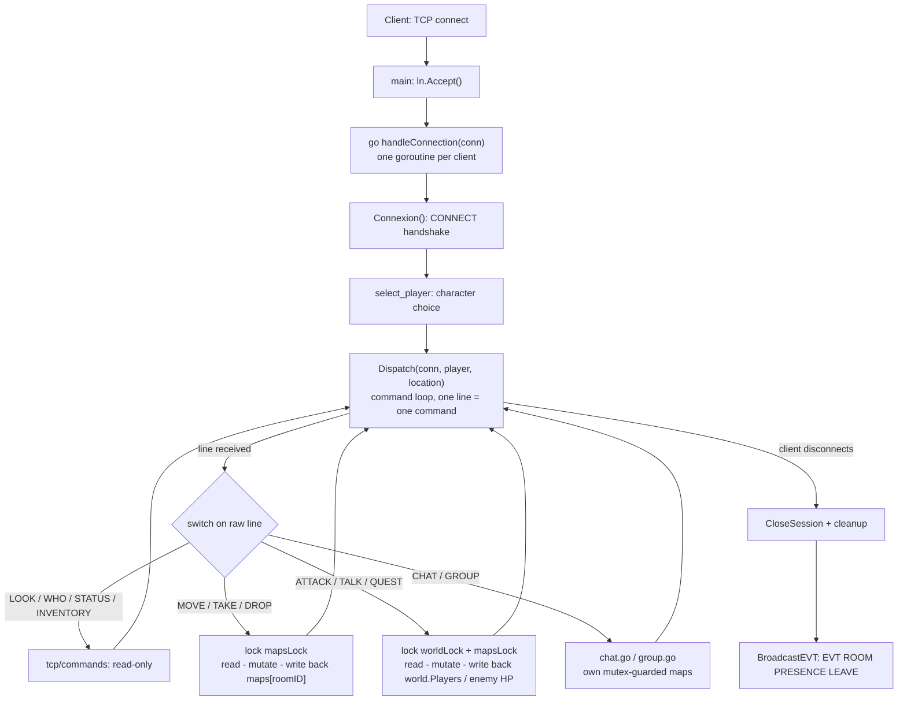
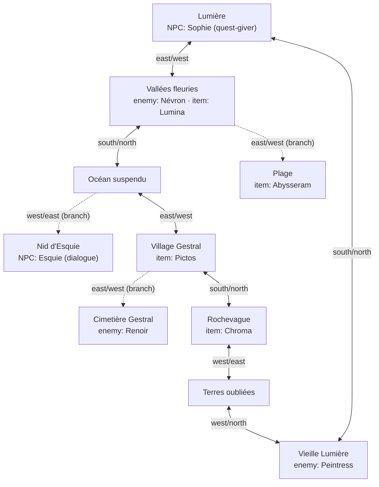
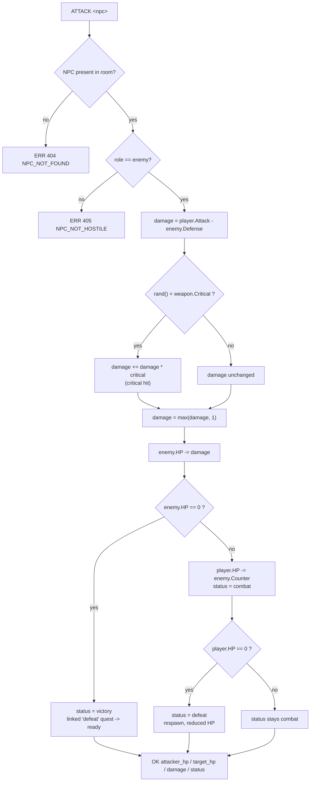
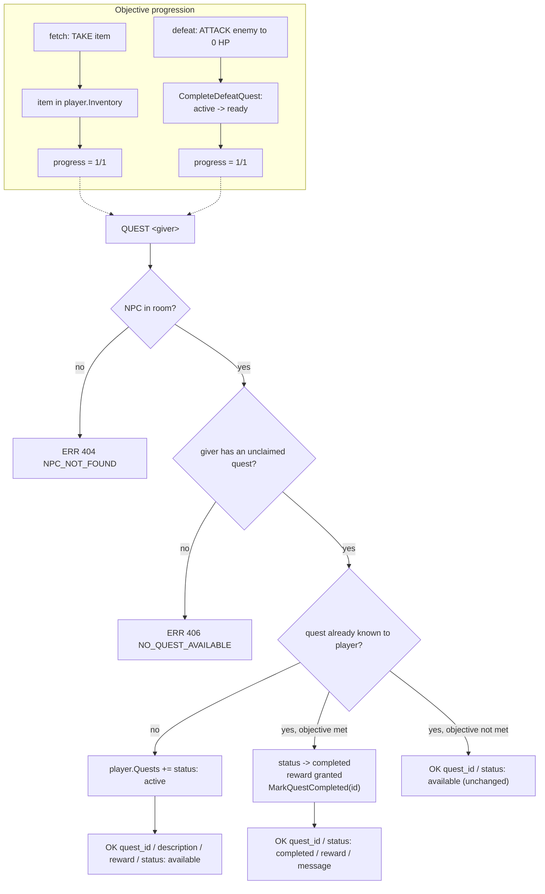

*This project has been created as part of the 42 curriculum by bbeaurai, fcaval, hguesne.*

# The-Answer-Protocol

## Description

TAP ("The Answer Protocol") is a shared-world, TCP-based multiplayer text
adventure (MUD) built for 42 School's TAP project. A Go server hosts a single
persistent world — rooms, items, NPCs, enemies, and quests — loaded from
`yaml/world.yaml`; any number of players (up to the size of the character
roster) connect at once over raw line-based TCP sockets and share that world in
real time: they explore rooms, chat (globally, per-room, or per-group), fight
enemies, collect and trade items, and complete quests, all while seeing each
other's presence, chat, and combat events live. Two clients are provided — a
CLI (`tcp/client`) and a Fyne-based desktop GUI (`client_main.go` + `gui/`) —
both speaking the same wire protocol described in `protocol-rfc.html` (RFC
42TAP), with the actual, verified deviations from that RFC documented below in
[Protocol Implementation](#protocol-implementation).

## Instructions

Requires Go 1.25+ (see `go.mod`). Quick start:

```sh
make install    # go mod tidy — fetch dependencies
make server     # terminal 1: start the TCP server on localhost:8080
make gui        # terminal 2: connect with the GUI client (or `make client` for CLI-only)
```

See [Building and Running](#building-and-running) below for every target, what
each one does, and how to run several clients at once.

## Resources

- [pkg.go.dev/net](https://pkg.go.dev/net) and [pkg.go.dev/encoding/json](https://pkg.go.dev/encoding/json) — Go standard library docs for the TCP
  listener/connection handling (`tcp/server`) and the JSON wire encoding used
  throughout (`tcp/conversion.go`, `tcp/commands/*.go`).
- [gopkg.in/yaml.v3](https://pkg.go.dev/gopkg.in/yaml.v3) — YAML parsing library used to load `yaml/world.yaml` (`parsing/*.go`).
- [Fyne documentation](https://docs.fyne.io/) — GUI toolkit used for the desktop client (`gui/*.go`).
- [chzyer/readline](https://pkg.go.dev/github.com/chzyer/readline) — line-editing library used for the CLI input loop (`client_main.go`).
- [RFC 5234 (ABNF)](https://www.rfc-editor.org/rfc/rfc5234) and [RFC 2119](https://www.rfc-editor.org/rfc/rfc2119) — referenced by this project's own protocol
  spec (`protocol-rfc.html`, RFC 42TAP) and used as background when comparing
  the actual server behavior against that spec.

**AI usage:** Claude (Claude Code) was used to help document this project —
specifically to read the actual server/client source and world data, verify it
command-by-command against `protocol-rfc.html`, and draft the Architecture,
World Design, Combat System, Quest System, Protocol Implementation, Server
Logging, Building and Running, and Testing sections (including the Mermaid
diagrams) from that verification, rather than from assumptions. It was not used
to write the Go source code itself. Every factual claim below (response
formats, error codes, room layout, file/line references) was checked against
the code in this repository as of the time of writing rather than generated
from a general description of the project.

## Architecture

The server (`tcp/server`, package `main`) accepts TCP connections in an infinite loop
and spawns one goroutine per client (`handleConnection`). There is no dispatcher
object: routing is a single `switch`/`case` over the raw line received
(`Dispatch` in `dispatch.go`). Live state is held in package-level globals guarded
by their own mutexes rather than in one shared "state" object — `maps` /
`mapsLock` (current room contents: who/what is where) and `world` / `worldLock`
(static world data, but also mutated for things like enemy HP and quest state).
Chat and group membership live in their own maps in `var.go`, intentionally kept
separate from `maps`/`world`. The lock/read-copy/mutate/write-back pattern is used
consistently: take the relevant lock(s), read a copy of the room or player, mutate
the copy, write it back, unlock.



## World Design

The world (`yaml/world.yaml`) is a single connected map of 10 rooms forming one
main loop (Lumière → Vallées fleuries → Océan suspendu → Village Gestral →
Rochevague → Terres oubliées → Vieille Lumière → back to Lumière), with three
dead-end branches (Plage, Nid d'Esquie, Cimetière Gestral) hanging off it —
satisfying both the "loop" and "optional branch" requirements. NPC roles are
spread across the three required kinds: dialogue (Esquie), quest-giver (Sophie),
and enemy (Névron, Renoir, Peintress). Obtainable items (Lumina, Abysseram,
Pictos, Chroma) are placed in distinct rooms along the loop and branches so
exploring the full circuit is required to collect them all.



## Combat System

Combat is resolved synchronously inside a single `ATTACK <npc>` command — there is
no separate turn queue or initiative order: the player always strikes first, and
the enemy counter-attacks only if it survives the hit (see `Attack` in
`tcp/commands/interact.go`). Damage is `player.Attack - enemy.Defense`, floored at
1 so an attack can never deal 0. Each weapon carries its own `critical` chance
(rolled with `math/rand/v2`); on a crit, damage is boosted by `damage * critical`
and the crit is reported back as a dedicated message. A defeated enemy (`HP == 0`)
resolves as `victory` and, if it was a quest's `defeat` target, flips that quest's
status to `ready` for pickup at the quest-giver. Otherwise the enemy counters for
its own fixed `Counter` damage; if that brings the player to 0 HP, the result is
`defeat` and the player respawns at a safe location with reduced HP. There is no
initiative roll and no `DEFEND`/`FLEE` command: the player always acts first and
the enemy's only possible response is its fixed counter-attack, which keeps a
single `ATTACK` call fully resolvable in one request/response round trip — adding
a turn queue or extra commands would require the protocol to support multi-step
combat turns, which RFC 42TAP's synchronous command/response model does not.



## Quest System

A quest is requested and turned in with the same command, `QUEST <giver-npc>`
(`ReturnQuest` in `tcp/commands/quests.go`): the first call against a given giver
registers the quest as `active` on the player and returns its description; a
later call, once the objective is met, grants the reward, flips the quest to
`completed`, and marks it globally completed so it can never be re-offered to
anyone for the rest of the server's lifetime. There are two objective types:
`fetch` (met as soon as the item is present in `player.Inventory`) and `defeat`
(met once `CompleteDefeatQuest` — triggered from the `ATTACK` victory path — has
flipped the quest to `ready`). Both converge on the same "1/1, go turn it in"
state exposed by the `QUESTS` command, no separate completion command exists.



## Protocol Implementation

The wire format was implemented against this project's own worked examples
(subject §V.5, e.g. `WHO` → `OK { "room": [...], "server": N }`) more than
against RFC 42TAP's ABNF, and every state-changing command additionally pushes a
raw JSON dump of the current room right after its reply so both clients can
refresh their view without issuing a follow-up `LOOK`. The table below lists the
verified deviations from the RFC text, command by command.

| Command | RFC 42TAP specifies | Actual server behavior |
|---|---|---|
| Initial greeting | `OK hello proto=1` sent right after the TCP handshake | Nothing is sent until the client sends `CONNECT` |
| `CONNECT` | `CONNECT <username>`, reply `OK connected` | Client sends bare `CONNECT` (no argument). Server replies with a numbered menu of a fixed character roster (`PersoChoice` in `tcp/commands/session.go`); the client answers with a number, not a name. `OK connected` is never sent — success is a free-text welcome line, followed by two unsolicited, unprefixed raw JSON lines (the whole `WorldFile`, then the player's starting `Location`) |
| `WHO` | `OK players=<count>` | `OK {"room":[<names in room>],"server":<total connected>}` |
| `MOVE` | `OK room=<room-id>` | No `OK`-prefixed line: the destination `Location` is sent as raw JSON, followed by a French text line ("Vous êtes maintenant dans X"). Failure: `[SERVER] ERRNO 301: ...` (free text) instead of `ERR 301 NO_EXIT` |
| `TAKE` | `OK taken=<item-id>` | `[SERVER] Vous avez pris l'objet: <name>` (not `OK`-prefixed) + a raw room JSON dump. Failure: `[SERVER] ERRNO 404: ...` instead of `ERR 404 ITEM_NOT_FOUND` |
| `DROP` | `OK dropped=<item-id>` | Same pattern as `TAKE`: `[SERVER] Vous avez déposé l'objet: <name>` + raw room JSON, `[SERVER] ERRNO 404: ...` on failure instead of `ERR 404 ITEM_NOT_IN_INVENTORY` |
| `LOOK` | `OK <json>` | Matches: `OK {"room":{...},"players":[...],"items":[...],"npcs":[...]}`, plus an added `"enemies"` array |
| `TALK` | `OK <dialogue>` | `OK [<npc>]: <dialogue>` — dialogue text is prefixed with the NPC's name |
| `INVENTORY` / `STATUS` / `QUESTS` / `QUEST` / `ATTACK` | one `OK`/`ERR` line | Each does emit one correctly-shaped `OK`/`ERR` line first, but it is always followed by a second, unprefixed raw JSON dump of the current room on the next line — that second line has no RFC equivalent |
| Error codes | fixed table in RFC §8.2 | The server also emits `ERR 404 PLAYER_NOT_FOUND`, `ERR COMMAND FAILED`, `ERR 400 INVALID_CHAT_COMMAND`, `ERR 409 ALREADY_EQUIPPED`, `ERR 406 NOTHING_EQUIPPED` — none of these codes/names appear in the RFC's error table |

Commands added beyond the RFC's command set:

- `EQUIP <item>` / `UNEQUIP` — switch the player's active weapon; not in the RFC.
- `ACCEPT` / `DECLINE` — reply to a pending `GROUP INVITE`; not in the RFC.
- A bare `CHAT` (no scope) opens an interactive sub-prompt asking for
  `GLOBAL`/`ROOM`/`GROUP` before the message, in addition to the RFC's one-line
  `CHAT <scope> <message>` form — both are accepted.
- Sending the exact same line twice in a row (except `ATTACK`, which is expected
  to repeat during combat) is treated as a flood warning: it is logged and
  echoed back as `[SERVER][WARN] ...` instead of being processed.

## Server Logging

Every log line goes through `LogAndPrintf`/`LogAndFprintf` (`tcp/common/common.go`),
which write the same line to **both** `protocol.log` (recreated on each server
start, `log.Ldate|log.Ltime` timestamps) and the originating connection/stdout,
so nothing is logged without also being visible to whoever triggered it. In
practice:

- **Connections/disconnections**: logged with the remote address
  (`conn.RemoteAddr()`, i.e. IP:port) and a timestamp, on connect
  (`server.go`), character selection (`session.go`), and disconnect
  (`close_session.go`).
- **Every command received** is logged before being processed
  (`Dispatch`/`Connexion` in `tcp/server`: `LogAndPrintf(conn, "%s| %s",
  conn.RemoteAddr().String(), message)`), with the player's connection and the
  raw command line.
- **Responses and errors** are logged via the same `LogAndFprintf` call that
  sends them to the client, so the log mirrors exactly what each client saw
  (including `ERR ...` lines).
- **World state changes** (item taken/dropped, movement, combat results, quest
  completion) are logged as they happen, alongside the JSON room-state dumps
  described in [Protocol Implementation](#protocol-implementation).
- **Basic abuse detection**: sending the exact same line twice in a row (except
  `ATTACK`, expected to repeat during combat) is logged as `[WARN]` and echoed
  back to the client instead of being processed — the only flood-mitigation in
  place.

**Known gap vs. the subject:** logs are plain text (`log.Printf`/`fmt.Fprintf`
lines), not structured JSON, and log levels only appear as ad hoc `[INFO]`
/`[WARN]`/`[ERROR]` string prefixes on some (not all) lines rather than a
consistent structured field. There is no rate-limiting or per-connection abuse
counter beyond the duplicate-line guard above. Documented here rather than
overstated, per the same "any deviation must be documented" rule applied to the
protocol itself.

## Building and Running

The build system is a `makefile` at the repository root, driving `go run`/`go
vet` directly (no separate compiled binaries are produced by these targets):

| Target | Command | Purpose |
|---|---|---|
| `make install` | `go mod tidy` | Install/sync Go module dependencies |
| `make server` | `go run ./tcp/server` | Start the TCP server on `localhost:8080` |
| `make stop-server` | `fuser -k 8080/tcp` | Force-kill anything still bound to port 8080 |
| `make client` | `go run ./tcp/client` | Standalone CLI-only client |
| `make gui` | `go run . gui` | Root client in GUI mode (Fyne window + input loop) |
| `make lint` | `go vet ./...` | Static analysis |
| `make clean` | removes `server`, `tap-gui`, `*.log`, Go build cache | Clean build artifacts |

Typical session: `make install`, then `make server` in one terminal, and `make
client` or `make gui` in another (repeat for additional players — the roster in
`yaml/world.yaml` caps how many can be connected at once). Run `make
stop-server` before restarting the server if port 8080 is still bound from a
previous run.

> **Note:** the subject's grading grid names the run targets `run-server`,
> `run-client`, and `run-client-gui`; this Makefile instead names them `server`,
> `client`, and `gui`. Functionally equivalent, but worth reconciling with your
> evaluator's expectations before the defense.

## Group Contributions

Based on Git history (`git shortlog -sn`, and per-directory commit counts) —
adjust the wording below if it doesn't match how the group actually split the
work, since commit counts reflect who typed the code, not necessarily who
designed it:

- **hguesne** — primary contributor to the server (`tcp/server`: connection
  handling, dispatch loop, chat/group state) and command logic
  (`tcp/commands`: combat, quests, session/character selection).
- **bbeaurai** — world data and parsing (`yaml/world.yaml`, `parsing/*.go`:
  world loading and cross-reference validation), plus contributions across the
  server and GUI code.
- **fcaval** — primary contributor to the GUI client (`gui/*.go`: Fyne
  interface, session hand-off, room/character panels, chat and map dialogs).

## Testing

There is no automated test suite (no `*_test.go` files in the repository); the
project is verified manually. `go vet ./...` (`make lint`) is the only
automated check. Suggested manual test flow:

- **Protocol-level**: connect directly with `nc localhost 8080` (or `telnet`)
  and send raw lines by hand to check exact wire formats and error paths
  against the table in [Protocol Implementation](#protocol-implementation) —
  useful for spotting regressions the clients might silently paper over.
- **Multiplayer/presence**: run `make server`, then two or more `make client`
  / `make gui` instances at once; move one player between rooms and confirm
  the others see `EVT ROOM PRESENCE ENTER/LEAVE`, and that `CHAT GLOBAL` /
  `CHAT ROOM` / `CHAT GROUP` only reach the intended audience.
- **Items**: `LOOK`, `TAKE`/`DROP` an item by both its ID and its display name
  (including a multi-word one, e.g. "Brise barrière"), and confirm with `LOOK`
  that it disappears from the room and appears in `INVENTORY`, and that a
  second player cannot take it while it's held.
- **Combat**: move a character to a room with an enemy (e.g. Vallées fleuries →
  Névron), `STATUS` to confirm starting HP, then repeat `ATTACK <enemy>` and
  watch HP/`status` change until `victory` or `defeat` (respawn at reduced HP).
- **Quests**: `QUEST` a quest-giver NPC (e.g. Sophie in Lumière) to accept,
  fulfil the objective (fetch the item, or defeat the linked enemy), then
  `QUEST` the same NPC again to collect the reward, and check `QUESTS` reflects
  `active` → `ready`/`waiting` → `completed` at each step.
- **Disconnect handling**: close a client mid-session (Ctrl+C or kill the
  process) and confirm the server logs the disconnect, removes the player from
  `WHO`/room state, and keeps serving other clients.
